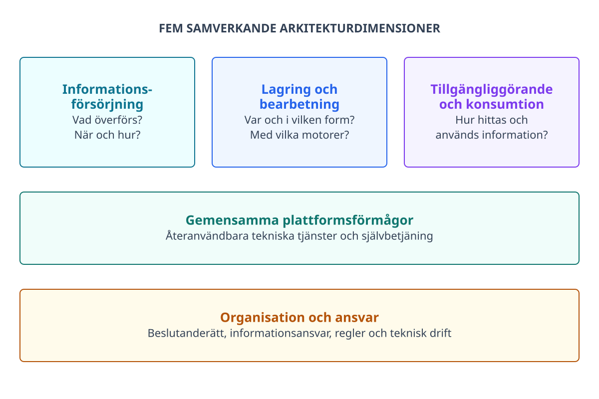

# 3. Dataarkitekturens dimensioner och centrala vägval

Anta att den fiktiva referensmyndigheten överväger att ersätta sitt Data Warehouse med ett Lakehouse, samtidigt som den vill införa Data Mesh. Är detta två alternativa lösningar eller delar av samma förändring? Frågan går inte att besvara utan att först skilja mellan de problem som respektive koncept är avsett att lösa.

Gieß och Hutterer jämför i en litteraturöversikt från 2025 dataplattformar, Data Mesh, Data Fabric och Data Spaces, bland annat utifrån styrning och tillämpningsområde. De diskuterar möjliga kombinationer och framhåller bristen på empiriska jämförelser av konceptens effektivitet i praktiken [K008]. Bokens analysramverk tar fasta på denna begreppsskillnad, men är en egen indelning anpassad till arkitekturbeslut inom en större organisation.

## Fem dimensioner av dataarkitekturen

### Lagring och bearbetning

Den första dimensionen handlar om var data lagras, hur den representeras och med vilka mekanismer den bearbetas. Här ingår valet mellan exempelvis ett integrerat Data Warehouse, ett Lakehouse och specialiserade datalager. Valet behöver ta hänsyn till de arbetslaster som beskrevs i föregående kapitel. Det kan också behöva göras separat för olika informationsmängder inom samma organisation.

Ett beslut om gemensam lagring innebär inte nödvändigtvis att all bearbetning måste ske i samma motor eller att ett enda team ansvarar för all information.

### Informationsförsörjning

Den andra dimensionen omfattar vägen från informationsproducenten till den miljö där informationen ska användas. Arkitekturen behöver definiera vad som överförs, när det sker, hur förändringar hanteras och vem som ansvarar för att leveransen fungerar.

Ett operativt IT-stöd kan exempelvis publicera förändringar till en gemensam mottagningstjänst eller leverera periodiska utdrag. Båda mönstren kan försörja samma datalager. Det är därför möjligt att ändra överföringsmönster utan att byta lagringsarkitektur, förutsatt att mottagningens gränssnitt och informationskrav kan uppfyllas.

### Tillgängliggörande och konsumtion

Den tredje dimensionen handlar om hur konsumenter hittar, förstår och använder information. En analytiker kan behöva en frågebar tabell med historik, medan ett IT-stöd kan behöva ett avgränsat tjänstegränssnitt. En gemensam definition av ett verksamhetsmått kan behövas för att olika rapporter ska bli jämförbara.

Valet av åtkomstform ska inte förväxlas med valet av fysisk lagring. En konsument kan exempelvis få åtkomst till en logisk vy över flera datalager utan att veta hur varje källa är lagrad. Det kräver dock att åtkomstlösningen uppfyller krav på bland annat prestanda, behörighet och tydliga informationsdefinitioner.

### Gemensamma plattformsförmågor

Den fjärde dimensionen gäller vilka återanvändbara tekniska tjänster organisationen behöver för att utveckla och förvalta sin datahantering. Det kan handla om att etablera dataflöden, köra bearbetningar, registrera metadata, tilldela behörigheter eller övervaka leveranser.

En gemensam dataplattform kan erbjuda sådana tjänster oberoende av om de underliggande lagren är av samma typ. Arkitekten behöver skilja mellan den funktionalitet som organisationen behöver kunna erbjuda och hur den realiseras genom produkter och tekniska komponenter. Det är också viktigt att skilja en tjänst som ett team faktiskt kan använda på egen hand från ett verktyg som endast är tillgängligt via en specialistgrupp.

### Organisation och ansvar

Den femte dimensionen rör beslutanderätt och ansvar för information, leveranser, gemensamma regler och teknisk drift. Ett team som känner verksamhetens informationsbehov kan ansvara för betydelsen och kvaliteten hos en dataprodukt även om ett centralt plattformsteam driver den tekniska miljön.

Goedegebuure med flera beskriver i en systematisk genomgång av 114 branschpublikationer om Data Mesh hur domänansvar, data som produkt, en självbetjänad dataplattform och federerad, maskinellt understödd styrning ingår i konceptet [K006]. Det visar att Data Mesh omfattar flera arkitekturdimensioner samtidigt. Översikten sammanställer praktikers beskrivningar och ger inte i sig belägg för att en sådan organisation alltid är effektivare än en centraliserad organisation.

## Centralisering är inte ett enda vägval

Fysisk lagring, logisk åtkomst, informationsansvar, teknisk förvaltning och styrning kan centraliseras i olika grad. Ange därför alltid vilken dimension ett beslut gäller. Kapitel 15 jämför organisatoriska modeller och deras förutsättningar.

## Från verksamhetsbehov till verifierbart arkitekturval

Utgå från en observerad begränsning i den berörda arkitekturdimensionen. Vid långa ledtider för förändringar i informationsförsörjningen behöver orsaken exempelvis lokaliseras innan ett byte av lagringsprodukt övervägs; kapitel 9 analyserar sådana förändringsberoenden.

Arkitekturval bör därför härledas från verksamhetsbehov via arkitekturdrivande krav, arkitekturmönster och nödvändiga plattformsförmågor till teknisk realisering. Produktalternativ bedöms mot dessa krav och förmågor, med återkoppling när teknisk genomförbarhet eller kostnad kräver att ett tidigare vägval omprövas. Kraven behöver vara tillräckligt konkreta för att verifieras; exempelvis en högsta tolererad fördröjning eller en mätbar ledtid för en schemaändring.

Följande bedömningsdimensioner används genom boken. De är inte ytterligare arkitekturlager utan frågor som ska ställas om ett föreslaget alternativ.

| Bedömningsdimension | Fråga att besvara |
|---|---|
| Verksamhetsnytta | Vilka användningsbehov tillgodoses och vilken begränsning minskar? |
| Tekniska egenskaper | Klarar lösningen arbetslast, aktualitet och tillgänglighetskrav? |
| Utveckling och förvaltning | Vilken kompetens, ledtid och löpande arbetsinsats krävs? |
| Organisation och ansvar | Har berörda team mandat och resurser för sitt ansvar? |
| Säkerhet och handlingsfrihet | Uppfylls skyddsbehov, livscykelkrav och krav på framtida flyttbarhet? |
| Ekonomi | Vilka kostnader uppstår för införande, användning, förvaltning och avveckling? |

Vissa krav är absoluta villkor snarare än egenskaper som får vägas mot varandra. Ett alternativ som inte uppfyller ett bindande skyddskrav blir inte godtagbart bara för att det har lägre kostnad. För de alternativ som uppfyller villkoren kan avvägningar göras utifrån verksamhetens prioriteringar. Beslutet behöver därefter prövas genom mätning av de valda kraven, exempelvis faktisk publiceringsledtid och antal specialistinsatser per förändring.

Baselkommitténs uppföljning från 2023 av riskdataaggregering och rapportering omfattade 31 banker som hade klassats som globalt systemviktiga under perioden 2011–2021. Trots lång tid sedan principerna infördes återstod betydande arbete hos flertalet banker [K024]. Det är en erfarenhet från banksektorn, inte ett regelverk för svenska myndigheter eller ett bevis för att ett visst arkitekturmönster misslyckats. Den ger ändå anledning att behandla förmågan att faktiskt upprätthålla styrning och informationskvalitet som en viktig del av utvärderingen, inte bara som ett dokumenterat mål.

Med denna referensram går det att jämföra lagringsalternativ på deras egna meriter och samtidigt förstå hur de passar in i organisationens större dataarkitektur. De följande kapitlen börjar med lagring och bearbetning; de övriga dimensionerna fördjupas därefter.
