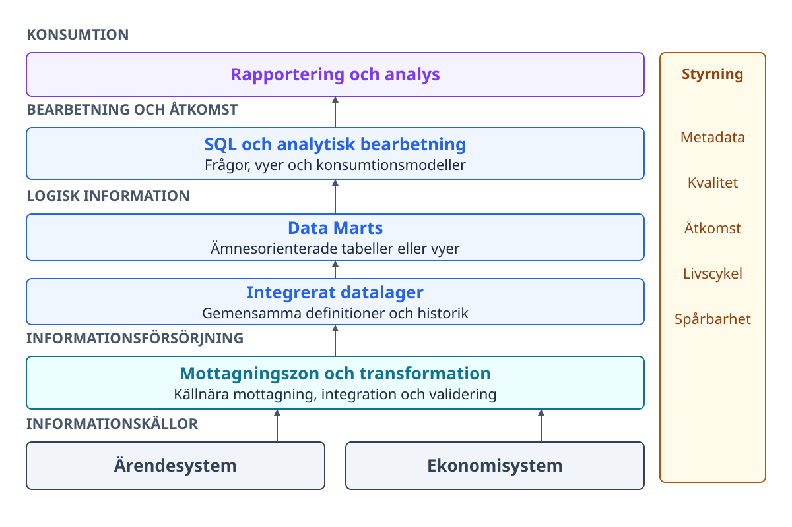

# 4. Data Warehouse

Ett Data Warehouse kan ha en central roll i en modern dataarkitektur även när organisationen behöver hantera nya informationsformat, kortare ledtider och fler typer av analys. Det avgörande är vilka uppgifter datalagret ska lösa, inte hur länge arkitekturkonceptet har funnits.

Ett Data Warehouse, här förkortat DWH, är ett analytiskt datalager där information organiseras för bland annat uppföljning, jämförelser och analys över tid. I ett organisationsgemensamt DWH kan information från flera operativa IT-stöd sammanföras till en användbar helhet. Det kräver mer än att data lagras i samma databas: betydelsen av uppgifterna måste också kunna förenas.

## Datalagrets logiska struktur

En vanlig arkitektur skiljer mellan mottagning, integration och konsumtion. Oracle beskriver exempelvis en struktur med ett centralt datalager, en mottagnings- och bearbetningsmiljö samt ämnesorienterade Data Marts [K041]. Denna indelning är logisk; delarna behöver inte realiseras som separata produkter.

| Del | Huvudsaklig funktion |
|---|---|
| Mottagningszon (stage area) | Ta emot och vid behov mellanlagra källnära information |
| Integrerat datalager | Sammanföra och historisera information enligt definierade regler |
| Data Mart | Tillgängliggöra information för ett ämnesområde eller en avgränsad användargrupp |

I referensmyndigheten finns redan systemspecifika mottagningszoner. Ett ärendehanteringssystem levererar exempelvis ärenden och beslut, medan ett ekonomisystem levererar betalningar. Att dessa uppgifter finns i samma datalagermiljö innebär inte att det går att summera betalningar per beslut utan vidare. Relationerna mellan ärenden, beslut och betalningar behöver etableras, och det måste vara tydligt hur delbetalningar, omprövningar och rättelser behandlas.

Det integrerade lagrets värde ligger därför i att hantera sådana samband och göra reglerna återanvändbara. En Data Mart kan därefter presentera informationen i en struktur som är lämplig för exempelvis ekonomisk uppföljning. Den kan bestå av fysiska tabeller, vyer eller en kombination. Fysisk materialisering kan motiveras av svarstidskrav, men innebär samtidigt att ytterligare data behöver hållas aktuella.

En arkitektur där varje rapport hämtar information direkt från mottagningszoner kan fungera för avgränsade behov. Risken uppstår när samma integrationsregler implementeras oberoende av varandra i många rapporter. En ändrad definition kan då behöva införas på flera ställen och leda till olika resultat under övergången.

## Tre modelleringsansatser

Valet av informationsmodell är skilt från valet av databasmotor. En modern kolumnorienterad databas kan exempelvis användas för både ett normaliserat datalager och dimensionsmodeller.

### Dimensionsmodellering

Dimensionsmodellering organiserar information kring mätbara verksamhetshändelser och de sammanhang i vilka de ska analyseras. Kimball Groups etablerade metodbeskrivningar betonar bland annat faktatabellens granularitet, gemensamma dimensioner och hantering av föränderliga dimensionsattribut [K042].

En faktatabell kan representera en rad per betalning, med belopp som mätvärde och kopplingar till dimensioner för datum, betalningstyp och organisatorisk enhet. En annan faktatabell kan representera beslut. Det är viktigt att dessa tabellers granularitet inte blandas ihop. Om flera betalningar hör till samma beslut kan en enkel sammanfogning exempelvis leda till att beslutets belopp summeras flera gånger.

I ett stjärnschema kopplas faktatabellen till dimensionstabeller som gör det möjligt att filtrera och gruppera resultat. Gemensamt definierade dimensioner kan användas av flera faktatabeller. Därmed kan information från olika verksamhetsprocesser analyseras tillsammans utan att varje analys behöver utveckla egna definitioner av exempelvis kalenderperiod eller organisatorisk enhet.

Dimensionsmodellering är särskilt användbar när analysfrågorna är återkommande och när användarna behöver tydliga mått och begripliga strukturer. Utmaningen är att nya frågor kan kräva en annan granularitet än den ursprungliga modellen. Ett datalager som enbart sparar månadsvisa summeringar kan inte i efterhand rekonstruera enskilda betalningar.

### Normaliserade modeller

En normaliserad modell, exempelvis i tredje normalformen (3NF), organiserar information kring entiteter och deras relationer och begränsar vissa typer av redundans. I ett integrerat datalager kan en sådan modell användas för att representera ärenden, beslut, betalningar och parter utan att utgå från en viss rapportstruktur. Normaliserade och dimensionella modeller förekommer inom datalagerarkitektur [K041] [K043].

En möjlig fördel är att en gemensam informationsmodell kan betjäna flera olika användningsområden. Samtidigt kan en omfattande integrerad modell bli kostsam att ändra om många informationsområden är beroende av samma definitioner. Normalisering löser inte i sig frågan om två källsystems begrepp verkligen betyder samma sak.

För analytiska användare kan modellen behöva kompletteras med enklare konsumtionsstrukturer. Det är därför inte nödvändigt att välja mellan 3NF och stjärnscheman för hela datalagret. En normaliserad integrationsmodell kan kombineras med dimensionsmodeller för utvalda användningsområden.

### Data Vault

Data Vault är en modelleringsansats där affärsnycklar, relationer och föränderliga attribut separeras. De grundläggande strukturerna är hubbar, länkar och satelliter [K043]. En hubb kan identifiera ett ärende, en länk kan representera sambandet mellan ärendet och ett beslut, och en satellit kan innehålla uppgifter om ärendets förändringar över tid.

Ansatsen kan vara intressant när många källsystem förändras oberoende av varandra och när historik och källspårbarhet har stor betydelse. Genom att skilja mellan identitet, relation och beskrivande information kan vissa förändringar hanteras lokalt i modellen. Det förutsätter dock att identiteter, tidsangivelser och källreferenser hanteras konsekvent.

En Raw Vault kan användas för källnära historik organiserad kring verksamhetsnycklar, medan en Business Vault kan innehålla resultat av tillämpade verksamhetsregler [K045]. Konsumtionen behöver ofta förenklas genom ytterligare modeller eller vyer. Ett stort antal tabeller och sammanfogningar kan annars göra analysen svår att förstå och optimera.

Data Vault är därför inte automatiskt enklare eller billigare än andra modeller. Automatiserad modellgenerering och laddning kan vara värdefull, men organisationen behöver fortfarande förvalta verksamhetsreglerna. För att reproducera en historisk rapport behöver även beräkningsregler, relevanta dataversioner och tidpunkten för rapportuttaget kunna återskapas.

| Modell | Typiskt motiv | Viktig avvägning |
|---|---|---|
| Dimensionell | Begriplig, återkommande analys | Granularitet och förändrade analysbehov |
| Normaliserad | Sammanhängande integrerad informationsbild | Modellberoenden och konsumtionskomplexitet |
| Data Vault | Källhistorik och föränderliga källor | Många strukturer och behov av vidare bearbetning |

Tabellen är en arkitekturanalys, inte en empirisk rangordning. Modellerna kan kombineras och behöver inte användas konsekvent i alla delar av ett datalager.

## Historik och gemensamma definitioner

Historik behöver utformas efter vilken fråga informationen ska besvara. Anta att en organisatorisk enhet byter namn eller att ett ärende flyttas mellan enheter. Ska den historiska uppföljningen visa organisationen sådan den såg ut vid beslutstillfället, eller ska äldre beslut redovisas enligt dagens organisation?

En dimensionsmodell kan hantera vissa sådana förändringar med Slowly Changing Dimensions. En typ 1-ändring skriver över ett tidigare attributvärde, medan typ 2 skapar en ny dimensionsversion för att bevara historiska värden [K042]. Båda kan vara lämpliga, beroende på vad attributet betyder. En rättelse av en felstavning behöver exempelvis inte behandlas på samma sätt som en verklig organisatorisk förändring.

För en myndighet kan det även finnas behov av att skilja mellan när ett förhållande gällde i verksamheten och när informationen registrerades i systemet. Ett beslut kan få retroaktiv verkan eller korrigeras efter att en statistikrapport har publicerats. Om båda tidsperspektiven är viktiga behöver de representeras uttryckligen. Lagring av historiska rader är inte tillräcklig om det saknas information om hur de ska tolkas.

Gemensamma mått behöver dessutom ha definierade beräkningsregler. Antalet avslutade ärenden kan avse avslut under en period, ärenden som för närvarande har status avslutad eller ärenden som aldrig återöppnats. Dessa mått är inte utbytbara. Ett DWH kan göra sådana definitioner återanvändbara, men de behöver fastställas tillsammans med verksamheten.

## Moderna tekniska realiseringar

Datalagerarkitekturen behöver inte vara bunden till en traditionell relationsdatabas på en enskild server. Som beskrevs i kapitel 2 kan kolumnorienterad lagring ge goda förutsättningar för analytiska arbetslaster. Moderna datalagermotorer kan även utnyttja parallell bearbetning, komprimering, partitionering och materialiserade resultat. Dessa egenskaper behöver bedömas mot de faktiska frågorna och datamängderna.

En annan utveckling är att lagring och beräkningsresurser kan skalas mer oberoende av varandra. Snowflakes dokumenterade arkitektur är ett exempel där flera separata beräkningskluster arbetar mot gemensamt lagrade data [K044]. Snowflake är en tjänst i publika moln och kan inte installeras lokalt [K044]. Exemplet illustrerar en teknisk princip, inte ett produktval för myndigheten eller ett krav för att något ska vara ett DWH. Det visar att en organisationsgemensam informationsbild inte måste innebära en enda gemensam beräkningsresurs. Separata beräkningskluster eliminerar dock inte alla gemensamma beroenden.

En modern datalagermotor kan också stödja semistrukturerade data, exempelvis JSON [K044]. Organisationen kan därmed i vissa fall behålla källnära attribut utan att omedelbart skapa en fullständig relationsmodell. För återkommande analyser behövs ändå tydliga definitioner och stabila representationer.

Det finns flera oberoende sätt att modernisera ett DWH: byta motor, förbättra informationsmodellerna, effektivisera laddningarna eller förändra hur data tillgängliggörs. De behöver inte genomföras samtidigt. Ett motorbyte löser exempelvis inte en situation där det tar flera månader att få en ny uppgift från ett operativt IT-stöd till analysmiljön.

## När bör datalagret vidareutvecklas?

Anta att referensmyndighetens DWH redan innehåller flera års kvalitetssäkrad historik och används för återkommande rapportering. Det är en tillgång som behöver värderas separat från databasmotorns tekniska livslängd. Att ersätta motorn är inte samma sak som att ersätta informationsmodellerna eller rapporternas beräkningsregler.

En vidareutveckling är särskilt intressant om informationsmodellerna fungerar väl, de huvudsakliga arbetslasterna är strukturerade och de tekniska begränsningarna går att åtgärda. Om problemet i stället är kostsam bearbetning av stora dokumentmängder eller behov av andra bearbetningsmotorer kan ett kompletterande datalager vara motiverat. En befintlig lösning kan då fortsätta svara för kvalitetssäkrad uppföljning utan att också behöva lösa alla nya behov.

| Observerad begränsning | Vad arkitekten bör undersöka först |
|---|---|
| Långsamma rapporter | Frågemönster, modell, fysisk design och resursfördelning |
| Lång ledtid för nya data | Informationsförsörjning, ansvar och beroenden |
| Motstridiga verksamhetsmått | Gemensamma definitioner och kvalitetssäkring |
| Svårhanterlig historik | Tidsmodellering, källspårbarhet och ändringsregler |
| Nya informationsformat | Motorns faktiska stöd eller kompletterande lagring |
| Hög förvaltningskostnad | Automatisering, kompetensbehov och teknisk komplexitet |

Innan en vidareutveckling beslutas behöver även motorns återstående supporttid, möjligheten att exportera data och kostnaden för fortsatt förvaltning bedömas. Krav på åtkomst och informationslivscykel måste kunna uppfyllas även för historik och materialiserade kopior. En praktisk utvärdering bör använda representativa frågor och förändringsscenarier: publicera ett nytt attribut, ändra en verksamhetsdefinition, rekonstruera ett historiskt resultat och köra en tung analys samtidigt med ordinarie rapportering. Mät både tekniska resultat och arbetet som krävs för att genomföra förändringen. En snabb frågemotor är inte tillräcklig om varje förändring av informationsinnehållet förblir ett omfattande specialistarbete.

Data Warehouse är alltså ett relevant alternativ när organisationen behöver en stabil, integrerad och analyserbar informationsbild. Om det bör vara den huvudsakliga lagringsarkitekturen, en av flera komponenter eller ersättas beror på vilka behov som inte kan tillgodoses på ett rimligt sätt. De kommande kapitlen beskriver andra lagringsmönster; den samlade jämförelsen görs i kapitel 8.
