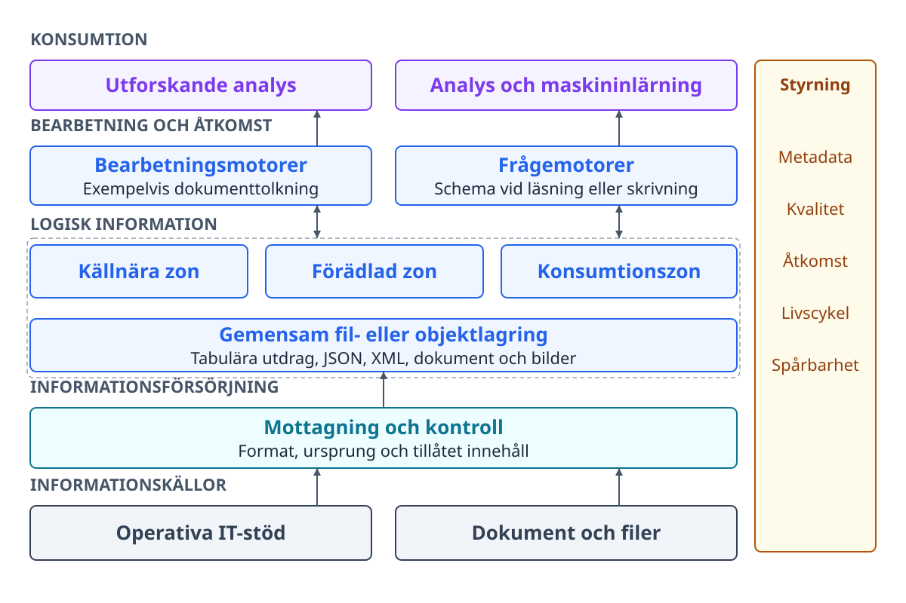

# 5. Data Lake

En myndighet som vill analysera innehållet i inskannade handlingar, jämföra händelseförlopp och utveckla modeller för riskbedömning behöver kunna arbeta med information som inte från början är anpassad till en gemensam analysmodell. Om varje nytt informationsslag först måste modelleras för ett centralt datalager kan vägen till en första analys bli lång. En Data Lake erbjuder ett annat sätt att organisera lagringen: informationen kan bevaras i en representation som ligger nära källan och förädlas för olika ändamål.

## Flexibel lagring som arkitekturprincip

En Data Lake är en miljö för att samla och bearbeta heterogena data utan att kräva att allt innehåll först anpassas till en gemensam relationsmodell. Forskningsöversikten av Azzabi med flera beskriver flexibiliteten i informationsformat och möjligheten att senarelägga schematolkningen som centrala egenskaper [K033]. En Data Lake är därför inte synonym med en viss lagringsprodukt, och en stor filyta är inte i sig en fungerande Data Lake.

För referensmyndigheten kan den flexibla lagringen exempelvis omfatta tabulära utdrag ur ärendesystem, JSON-meddelanden, XML-dokument, bilder och text. En bearbetningsmotor som läser strukturerade data behöver inte kunna tolka innehållet i en bild. Olika bearbetningsverktyg kan i stället utnyttja samma lagringsgrund där det är lämpligt. Ett dokument kan exempelvis bearbetas för att extrahera text, identifiera uppgifter och skapa ett tabulärt analysunderlag. Dokumentet och analysunderlaget har då olika funktioner och kan behöva olika åtkomstregler.

Flexibiliteten består inte i att informationen saknar struktur. En XML-fil har en struktur, och ett fotografi har ett tekniskt format. Det som kan senareläggas är valet av den informationsmodell som behövs för en viss bearbetning. Den ursprungliga representationen kan därmed användas för nya frågor, under förutsättning att informationen fortfarande får bevaras och användas.

## Distribuerade filsystem och objektlagring

Tidiga Data Lake-arkitekturer byggde ofta på Hadoop och dess distribuerade filsystem. Senare arkitekturer har utvecklats mot mer självständig skalning av lagring och bearbetning [K033]. I ett distribuerat filsystem som HDFS delas filer upp i block som lagras på flera noder. Filsystemets metadata gör det möjligt att hitta blocken och presentera dem som filer för applikationerna [K046].

Objektlagring erbjuder i stället ett gränssnitt där data hanteras som objekt identifierade med nycklar. Ett objekt kan exempelvis innehålla ett dokument eller en fil med många miljoner tabellrader. Sökvägsliknande nycklar innebär inte nödvändigtvis att lagringen har ett traditionellt filsystems kataloger eller samma garantier för operationer. Hadoop-projektets dokumentation beskriver bland annat skillnader i beteende vid namnbyte och andra filsystemoperationer när objektlagring används via en filsystemskoppling [K047].

Arkitekten behöver därför bedöma lagringsgränssnittet tillsammans med de motorer som ska läsa och skriva information. Att två produkter erbjuder ett liknande objekt-API betyder inte att alla operationer, säkerhetsfunktioner eller prestandaegenskaper är identiska. Objektlagring kan realiseras i egen drift eller som extern tjänst; valet av lagringsprincip avgör inte i sig driftplatsen.

En separat lagringstjänst kan göra det möjligt att tillföra beräkningsresurser utan att samtidigt utöka lagringskapaciteten. Men den introducerar också ett gemensamt beroende av nätverk och lagringstjänstens kapacitet. Utvärderingen bör omfatta både stora sekventiella läsningar och många samtidiga mindre operationer. Om varje händelse sparas som ett separat litet objekt kan antalet metadata- och åtkomstoperationer bli stort i förhållande till datavolymen. Att gruppera information i större filer kan då vara lämpligt, med en avvägning mot aktualitet och möjligheten att hitta enskilda poster.

## Schema-on-read och schema-on-write

Schema-on-read innebär att en läsare eller bearbetningsprocess tillämpar en struktur när data används. Schema-on-write innebär att en avsedd struktur tillämpas redan när data skrivs. Den första principen ger större utrymme att senare välja tolkning, medan den andra ger möjlighet att tidigare avvisa eller korrigera avvikelser. Skillnaden diskuteras i forskningen om Data Lake-arkitekturer [K033], men i praktiken kan båda principerna kombineras.

Anta att myndigheten tar emot XML-meddelanden med flera versioner av ett internationellt informationsformat. Originalmeddelandena kan bevaras i en källnära zon, samtidigt som deras formatversion och mottagningstid registreras. När informationen ska analyseras kan en bearbetning översätta versionerna till en gemensam representation. En annan bearbetning kan behöva undersöka skillnaderna mellan originalversionerna. Båda kan utgå från samma underlag.

Det betyder inte att alla kontroller bör skjutas upp. Kontroller av läsbarhet, källidentitet, formatversion och tillåtet informationsinnehåll kan behövas redan vid mottagningen. En förädlad tabell kan sedan ha ett strikt schema även om ursprungsmaterialet ligger i samma Data Lake. Om tio analysteam var för sig måste utveckla en tolkning av samma XML-format har flexibiliteten i lagringen inte omvandlats till återanvändbar information.

## Informationszoner

Zoner är ett sätt att skilja material med olika bearbetningsgrad och användningsvillkor. Forskningen beskriver flera varianter av zonbaserade arkitekturer [K033]. Följande indelning är ett exempel på hur principen kan anpassas till en reglerad organisation, inte en obligatorisk standard.

| Zon | Funktion |
|---|---|
| Mottagning | Tillfällig mottagning och kontroll innan material accepteras. |
| Källnära | Bevarad information med identifierbart ursprung och format. |
| Förädlad | Validerade och bearbetade dataset avsedda för återanvändning. |
| Konsumtionsanpassad | Representationer för specifika analyser eller andra användningsbehov. |
| Experiment | Avgränsade arbetsytor för undersökningar och utveckling. |

En zon är en logisk indelning och behöver inte motsvara en separat fysisk lagringsprodukt. För känslig information kan däremot starkare teknisk isolering krävas. Att ett dataset har förädlats betyder inte att det är mindre skyddsvärt; sammanställningen kan göra det lättare att dra slutsatser om enskilda personer eller verksamheter.

Zoner ska heller inte innebära att varje dataset alltid måste kopieras fem gånger. För vissa informationsslag behövs endast en källnära representation och ett förädlat resultat. Andra behöver flera bearbetningar. Varje kopia bör ha ett motiverat ändamål, en ansvarig och en definierad livscykel. Det är särskilt viktigt när experimentytor skapas snabbt och sedan riskerar att lämnas utan förvaltning.

## Från Data Lake till Data Swamp

Boukraa med flera sammanställer forskning om metadatahantering i Data Lake-miljöer och framhåller risken att lagrat innehåll blir svårt att använda när metadata inte byggs upp och underhålls [K034]. En sådan miljö brukar beskrivas som en Data Swamp. Problemet är inte främst att filerna är många, utan att det inte går att avgöra vad de representerar eller om de är lämpliga för ett visst ändamål.

En praktisk miniminivå är att varje förvaltat dataset har en identifierare, en ansvarig, en beskrivning av innehållet, uppgifter om ursprung och aktualitet samt dokumenterade användningsvillkor. Tekniska metadata, exempelvis filformat och schema, kan ofta samlas in maskinellt. Verksamhetsbetydelse och tillåtna användningsområden behöver däremot fastställas med stöd av personer som förstår informationen. En katalog som endast listar objekt och kolumnnamn är inte tillräcklig.

Förädling behöver dessutom kunna följas bakåt. Om en analys bygger på text extraherad ur dokument bör det vara möjligt att identifiera underlaget, bearbetningsversionen och vilka dokument som inte kunde tolkas. Om en ny extraktionsmetod införs behöver organisationen kunna avgöra om tidigare resultat måste ersättas eller behållas för spårbarhet. För att begränsa dubbelarbete är ett rimligt arkitekturval att förädla återkommande efterfrågad information i förväg, men behålla utrymme för ändamålsenlig utforskning.

Den fullständiga styrningen av metadata, kvalitet och informationslivscykel behandlas i kapitel 16 och 17. Redan vid valet av lagringsarkitektur behöver dock organisationen säkerställa att dessa förmågor kan realiseras. Rådata är inte ett argument för obegränsat bevarande.

## När tillför en Data Lake ett självständigt värde?

För referensmyndigheten kan en Data Lake komplettera ett etablerat Data Warehouse när det finns behov av att bearbeta dokument, undersöka nya informationskällor eller återanvända källnära data med flera typer av verktyg. Om ett resultat blir en stabil del av återkommande verksamhetsuppföljning kan det föras vidare till datalagrets gemensamma informationsmodell. Det är inte nödvändigt att flytta all befintlig rapportering till den nya miljön.

Ett införande bör knytas till konkreta behov och prövas med representativa informationsslag. Kan ett nytt dokumentformat tas emot och katalogiseras? Kan två oberoende bearbetningar använda samma underlag? Kan en analys återskapas med rätt version av underlag och bearbetningslogik, när bevarandevillkoren medger det? Kan en informationsmängd med tillhörande derivat hanteras enligt beslutade bevarande- och gallringsregler? Sådana tester ger mer vägledning än en jämförelse av enbart lagringspris per terabyte.

Om behovet huvudsakligen består av förutsägbar rapportering över redan välstrukturerade data kan ett ytterligare lagringslager innebära onödig komplexitet. Om däremot flexibel lagring kombineras med krav på samtidiga tabelluppdateringar, transaktionell konsistens och effektiv återanvändning i SQL-baserad analys kan en mer utvecklad tabellhantering vara motiverad. Det är utgångspunkten för nästa kapitel om Data Lakehouse.
